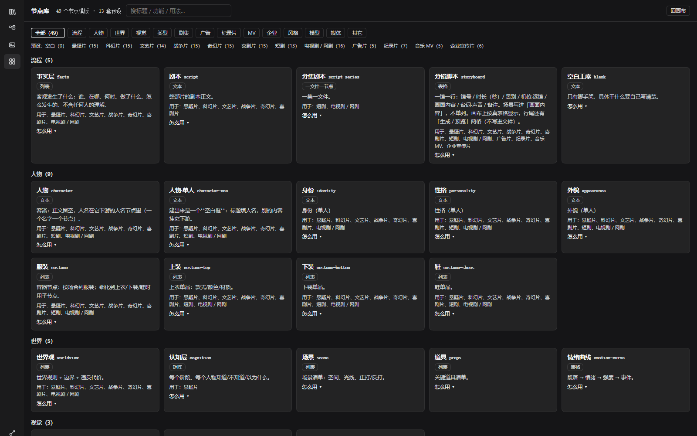

# 片厂 · FilmFlow

> 一张画布管一部片：从客观事实、剧本、分镜，到提示词和最终生成，全部落在你自己的磁盘上。
>
> 一个 AI 影视制作工作台：**工序画布 + 会改片子的 agent + 火山引擎媒体生成**。

---

## 这是什么

大多数 AI 视频工具是"对话框"：你描述，它生成，中间的**结构**（有几个人、每场戏讲什么、哪个镜头
用哪段台词、改了哪句会影响哪些镜头）全在模型的上下文里，人看不见、改不动。

片厂把这部片变成一张**工序树**：

- 每个方块是一道**工序**，也可以是片中一个具体的东西（人物、服装、场景、道具、画风……）；
- 工序之间用**依赖**连起来 —— 上游改了，下游自动标「⚠ 过期」，agent 按图去对齐；
- 每个方块有自己的**指令**（干什么 / 读什么 / 写到哪 / 什么格式 / 什么算做完），人和 agent 读同一份；
- 所有内容都是磁盘上的 markdown / json，**不是数据库、不是云端**，随时能打开、能改、能版本管理。

agent 不在天空里，它在这张图上干活：看板 → 读节点 → 提案 → 你确认 → 落盘。



---

## 功能

### 画布：一部片一棵树

- 每个方块是一道工序，方块里就是这一段的内容（markdown），点一下直接改，改完存回磁盘。
- 上游改过，下游方块自动标「⚠ 过期」—— agent 看一眼就知道该去改哪里。
- 滚轮缩放、按住滚轮平移；新建、改名、同层上下移、删除、撤销、重做。
- 位置由布局自己算，**不能手动拖**（故意的：每次打开都是同一张图，不会越挪越乱）。
- 分镜表固定贴在片名节点左边，一眼能看到全片镜头。

### 分镜表：分镜和生成在同一张表里

- 8 列按分镜习惯排：镜号、时长、景别、机位·运镜、画面内容、画风、台词·声音、备注。直接在表里加行、删行。
- 表格右边几列是操作区，不写进文件：用哪些参考图、什么模型 / 清晰度 / 比例、这一组的提示词、生成按钮、生成结果预览。
- 整张表铺开显示，不折叠。

### 参考图：让同一个角色在不同镜头里长得一样

- agent 读完分镜，会把片中的人物、场景、道具、画风列出来，画布上自动建好节点，你不用一个个手动建。
- 每个主体下有一个**图片节点**，把参考图放进去：本地的、本片素材库的、别的片子的都行（选别片的会自动复制一份进来）。
- 画布上有一条白线从主体连到表格里它出现的每一组镜头 —— 一眼看出"这张图用在哪几组镜头"。
- 换图只换一次，用到它的镜头全跟着变；某个镜头组就是不想用它，点一下「这个单元不用它」。
- 生成出来的图会自动收进这个图片节点，所以一个主体的所有图都在一处。

### 手加素材

表格里的 ＋ 加的是「素材1、素材2…」：没有种类、名字不带含义，同一张图全片同一个号，
用途写在你自己的提示词里。它和 agent 列的主体是两回事 —— 前者是"我临时想给它看这张图"，后者是"这个角色得有张脸"。

### 素材库

- 每组镜头会生成几条候选，挑一条点「采用」，预览就只显示采用的这条。
- 给图起个角色名（比如「唐老板」），就进了角色库，以后跨片挑参考图能直接看到。
- 别的片的图也能选，选完自动复制一份进本片，搬片、打包都不会断。
- 正被某个主体当参考图的素材，删之前会拦你一下。

### 生成

- 分镜是剪辑单位，生成是素材单位：一个「生成单元」覆盖 1~N 个镜头，模型出来的是一条连续镜头。
- 短于 4 秒的镜头必须和相邻镜并组（模型最短就是 4 秒）。
- 模型、清晰度、比例在表格里改，也可以让 agent 改（它会先校验：这个模型不支持的分辨率直接拒绝并说明）。
- 提示词由 agent 按模型规范写，发送前会检查一遍（画幅/清晰度/帧率不该写进正文、台词格式、镜头分段）。
- 参考图会真的随请求发给模型 —— 不是只写在提示词里。
- 视频用火山方舟 Seedance，图片用 Seedream，配音用豆包语音；产物按项目分文件夹进素材库。

### 和 agent 一起干活

- 聊天框的 ＋ 菜单里可以「引用画布素材」：选完输入框里是一张小图，发出去它知道你说的是哪张。
- 14 个工具：看全片、读一个节点、提改动、读写文件、对齐过期、改生成单元和参数、管模板、查模型提示词规范、上网。
- 正文改动先出提案卡，你点确认才落盘；表格这类结构化内容直接写（可 diff、可备份）。
- 顶栏能暂停正在跑的那一轮，也能切回旧会话。
- 片库删除是挪进 `_已删除/`，能搬回来；参考资料（`参考/`）只读，变了会自动叫醒 agent。

### 节点库与设置

- 49 个节点模板 + 13 套片型预设；任何节点的 ＋ 里都有「✎ 自定义节点…」，用自然语言描述要什么，agent 判断后存进模板库。
- API 设置分两段：Agent（默认 DeepSeek 官方，也可切火山方舟 v4.1）和 AIGC（方舟 + 豆包语音），AIGC 保存即生效。

## 快速开始

### 方式一：自行打包（Windows，推荐给最终用户）

本仓库**不附带**现成的便携包（DSH 运行时约 400MB，且发布包里不应带任何人的 API Key）。
打包方式：

1. 准备 DSH 运行时目录（含 `node_modules/@deepseek-ai/dsh` 和 `node.exe`）；
2. 把 `plugin/` 放到 `standalone/plugin/`，`plugin/standalone/server.mjs` 放到 `standalone/server.mjs`；
3. 用 `desktop/electron-builder.yml` 打包（`npx electron-builder --win portable`），
   `extraResources` 会把 `runtime/` 与 `standalone/` 一起带进包；
4. 首次启动会在 `%LOCALAPPDATA%\FilmFlow` 建数据目录，然后在「API 设置」里填自己的 Key。

> 便携包内置运行时，目标机器不需要装 Node / DSH。

### 方式二：从源码跑（开发）

本仓库是**片厂自己的代码**（插件 + 桌面壳 + 文档）。它跑在
[DeepSeek Harness](https://github.com/deepseek-ai)（下称 DSH）的插件架构上 —— **DSH 运行时不在本仓库里**，
需要你自己准备（例如从 DSH 的发布包或你已装的片场里取 `runtime/` 目录）。

目录结构：

```
plugin/                片厂插件（DSH host + browser 两半，零构建）
  index.js             宿主半：/filmflow/* 路由 + 14 把工具
  client-plugin/       浏览器半：画布 / 项目菜单 / 素材库 / 节点库（slot 注入）
  host/                规则矩阵、默认工程、媒体服务
  templates.json       49 个模板 + 13 套预设
  CONSTITUTION.md      agent 人格（运行时读它当系统提示词）
  filmflow.patch.yml   profile 叠加层（插件清单 / 模型 provider / 工具白名单）
  standalone/server.mjs  独立运行胶水（起 DSH、开端口、写 runtime.patch.yml）
desktop/               Electron 桌面壳（窗口、启动画面、数据目录、单实例锁）
docs/                  教程、截图、宣传片
```

开发运行（PowerShell）：

```powershell
# 1) 装依赖（只为桌面壳；插件本身零依赖、零构建）
cd desktop
npm install

# 2) 指向你的 DSH 运行时（含 node_modules/@deepseek-ai/dsh 的那一层）
$env:FILMFLOW_RUNTIME = "C:\path\to\dsh-runtime"
$env:FILMFLOW_ROOTS   = "$env:USERPROFILE\films"   # 你的片库根目录
$env:FILMFLOW_DATA_HOME = "$env:LOCALAPPDATA\FilmFlow"

# 3) 起桌面壳（它会拉起 standalone/server.mjs）
npm start
```

也可以只起服务、用浏览器打开：

```powershell
node plugin/standalone/server.mjs --port 3210 --no-open
# 浏览器访问 http://127.0.0.1:3210（带启动时打印的 token）
```

---

## 上手（五分钟）

### 先配两把钥匙

左侧轨道最下面的「API 设置」分两段：

- **Agent（DeepSeek）**：Key、Base URL `https://api.deepseek.com/anthropic`、模型 `deepseek-flash` —— 改完**重启**生效。
  这是默认的对话模型；想用**火山方舟 v4.1（DeepSeek-V4.1-Flash）**，把 `plugin/filmflow.patch.yml` 里
  `agentProvider/agentModel` 和 `agent-default-model` 两处改成 `ark-volcengine` / `deepseek-v4-1-flash-261017`，
  再把 `ARK_LLM_API_KEY` 写进凭据文件（**别**和出片用的 `ARK_API_KEY` 混用）。
- **AIGC（火山引擎）**：方舟 Key（Seedance 视频 / Seedream 图片）+ 豆包语音 Key（音频，可选） —— **保存即生效**。

1. **新建片子**：片库页 → 选片名 + 一套预设（悬疑 / 科幻 / 短剧 / 广告 / 纪录片…）→ 建。
2. **看画布**：左边是工序树。点方块改正文；方块上的 ＋ 是"往下建节点"，菜单里只列这一步能建的。
3. **和 agent 说话**：右边是官方会话框。让它"读一遍剧本，把人物抽到人物节点里"——它会先看板、再提案，
   你在卡片上点「确认」才落盘。
4. **生成**：给媒体节点选模型、写提示词，点生成；产物进素材库，按项目分文件夹。
5. **加自己的节点**：＋ →「自定义节点…」→ 告诉 agent 用途和格式 → 它建好并存进模板库（以后每部片都能用）。

更细的教程见 [docs/TUTORIAL.md](docs/TUTORIAL.md)，宣传片见 [docs/media/filmflow-intro.mp4](docs/media/filmflow-intro.mp4)。

---

## 数据放在哪

| 路径 | 内容 |
|---|---|
| `<片库根>/<片名>/.film/project.json` | **唯一声明**：工序、指令、产物、依赖、正文指向 |
| `<片库根>/<片名>/…` | 剧本、分镜、提示词、素材等 markdown / 媒体文件 |
| `%LOCALAPPDATA%\FilmFlow\dsh-home\` | DSH 配置、会话、凭据（`.credentials.yaml`） |
| `%LOCALAPPDATA%\FilmFlow\user-templates.json` | 你自建的节点模板（R58；升级不丢） |
| `%LOCALAPPDATA%\FilmFlow\films\` | 默认片库（可用 `FILMFLOW_ROOTS` 改） |

**没有任何内容上传到我们的服务器** —— 只有你配的模型/生成 API 会收到请求。

---

## 架构

```
┌──────────────────────────────┐
│ Electron 壳（desktop/main.js）│  窗口、启动画面、数据目录、单实例
└──────────────┬───────────────┘
               │ 启动
┌──────────────▼───────────────┐
│ DSH 运行时（node，外部依赖）   │  LLM 会话、工具调度、Web 服务
│  └─ /filmflow/* 路由          │
└──────────────┬───────────────┘
               │ 加载
┌──────────────▼───────────────┐
│ 片厂插件 plugin/              │
│  宿主半 index.js + host/      │  结构校验、依赖/过期、媒体任务、14 把工具
│  浏览器半 client-plugin/      │  画布/项目菜单/素材库/节点库（注入官方槽位）
└──────────────────────────────┘
```

- **零构建**：浏览器半是手写的 lazy-CJS 插件，DSH 直接加载，不需要打包器。
- **结构和内容分离**：`project.json` 说"有哪些工序、谁依赖谁、产物在哪"；正文在 markdown。
- **规则只有一份**：节点能建在哪、能不能连依赖，都读 `host/node-rules.js`；菜单、落盘、agent 提案共用同一套判断。
- **出处**：**程序架构出自 DeepSeek Harness（DSH）**。片厂是它的一个影视工作流插件 + 桌面壳，
  对话、输入框、工具卡、流式输出这些仍由 DSH 官方组件渲染，本仓库不包含 DSH 源码。

---

## 开发提示

- 改规则后跑：

  ```powershell
  node plugin/tools/rule-audit.mjs      # 规则表 / 骨架包 / 现有片子四层审计
  node plugin/tools/identity-scan.mjs   # 人物主从层（人物 → 人物·单人 → 属性 → 单品）
  ```

- `CONSTITUTION.md`（agent 人格）是**运行时读取**的，改完重启即可；`filmflow.patch.yml` 是 profile 叠加层（插件清单 / 模型 provider / 工具白名单），直接改。

- 新增节点模板：在 `templates.json` 加一条，并在 `host/node-rules.js` 的 `TEMPLATE_CHILDREN` 里
  声明它的下位（不写 = 叶子），然后跑审计。

---

## 已知限制

- 主要面向 **Windows**（便携包、路径、豆包语音都按 Windows 验证）。
- 源码运行需要 **DSH 运行时**，本仓库不附带（体积与授权原因）。
- 音频生成需要豆包语音控制台**开通服务**，且用的是「豆包语音」的 Key，不是方舟的 `ark-` Key。
- 行内生成 / 生成单元只对**表格形态**的分镜脚本生效；旧片的独立生成节点（`video-gen`）已从菜单隐藏，但仍可读、可删。
- 早期项目里有些节点没有记录"用哪个模板建的"，这部分节点的 ＋ 菜单会退回按大类显示（不追溯旧数据）。
- 参考素材目前只支持**图片**（视频 / 音频参考还没做）。
- 画风目前按「一套画风口径 + 一张对应参考图」用；同一部片要多种画风（比如实拍 + 回忆的手绘段），各建一套。

---

## 更新日志

最近一轮（2026-11-06）：画布上多了**连接线** —— 每个角色 / 场景 / 道具 / 画风有一张自己的参考图，
一条白线连到它出现的每一组镜头，换图只换一次；表格不再折叠、固定在片名左边；聊天框里可以直接挑一张画布上的图。
完整记录见 [CHANGELOG.md](CHANGELOG.md)。

## 许可

MIT。见 [LICENSE](LICENSE)。

## 致谢

- 架构与运行时：[DeepSeek Harness](https://github.com/deepseek-ai)
- 生成能力：火山引擎 方舟 Seedance / Seedream、豆包语音
- 本项目里的提示词速查（`plugin/guides/`）整理自上述模型的官方文档与公开资料
