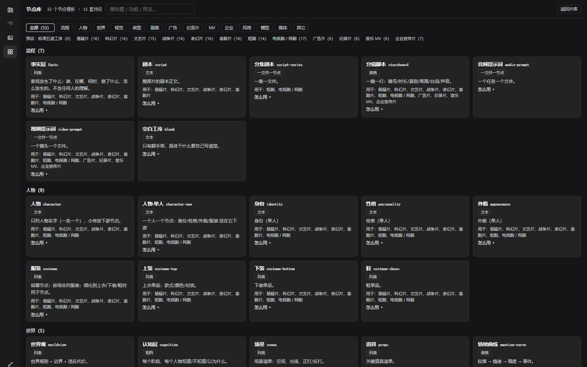

# 片厂 · FilmFlow

> 一张画布管一部片：从客观事实、剧本、分镜，到提示词和最终生成，全部落在你自己的磁盘上。
>
> 一个 AI 影视制作工作台：**工序画布 + 会改片子的 agent + 火山引擎媒体生成**。

---

## 这是什么

大多数 AI 视频工具是"对话框"：你描述，它生成，中间的**结构**（有几个人、每场戏讲什么、哪个镜头
用哪段台词、改了哪句会影响哪些镜头）全在模型的上下文里，人看不见、改不动。

片厂把这部片变成一张**工序树**：

- 每个方块是一道**工序**（也可以是一个元素：人物、身份、服装、上装、场景、提示词……）；
- 工序之间用**依赖**连起来 —— 上游改了，下游自动标「⚠ 过期」，agent 按图去对齐；
- 每个方块有自己的**指令**（干什么 / 读什么 / 写到哪 / 什么格式 / 什么算做完），人和 agent 读同一份；
- 所有内容都是磁盘上的 markdown / json，**不是数据库、不是云端**，随时能打开、能改、能版本管理。

agent 不在天空里，它在这张图上干活：看板 → 读节点 → 提案 → 你确认 → 落盘。



---

## 功能

- **工序画布**：树形布局、依赖导线、折叠、缩放、拖动；正文就地编辑；新建 / 删除 / 改名 / 移动 / 撤销 / 重做。
- **六种正文形态**：纯文本、条目列表、表格、矩阵、一任务一文件、下拉选择 —— 编辑器按形态解析，结构不会写歪。
- **节点库**：53 个节点模板（流程 / 人物 / 世界 / 视觉 / 类型 / 剧集 / 广告 / 纪录片 / MV / 企业 / 风格 / 模型 / 媒体）+ 13 套片型预设。
- **自定义节点**：任何节点的 ＋ 里有「✎ 自定义节点…」—— 用自然语言告诉 agent 要什么，它写好节点、存进模板库，并挂在这一步下面。
- **13 把 agent 工具**：看板 / 读节点 / 提案 / 检索 / 对齐 / 下游直写 / 模板库 / 存节点 / 写媒体参数 / 读文件 / 写文件 / 上网 / 模型提示词速查。
- **媒体生成**：火山方舟 Seedance（视频）、Seedream（图片），豆包语音（音频/配音）；素材库按项目分文件夹。
- **API 设置**：Agent 用 DeepSeek；AIGC 用火山（方舟 + 豆包语音）—— 两段分开，AIGC 保存即生效。

---

## 快速开始

### 方式一：直接用发布包（Windows）

到 [Releases](https://github.com/Georgelemon1/filmflow/releases) 下载便携包，解压后运行 `FilmFlow.exe`，
首次启动会在 `%LOCALAPPDATA%\FilmFlow` 建数据目录。然后在「API 设置」里填：

- **Agent**：DeepSeek API Key（`sk-…`）、Base URL `https://api.deepseek.com/anthropic`、模型 `deepseek-flash`；
- **AIGC**：火山方舟 API Key（`ark-…`）、豆包语音 API Key（音频用，可选）。

> 便携包内置运行时，目标机器不需要装 Node / DSH。

### 方式二：从源码跑（开发）

本仓库是**片厂自己的代码**（插件 + 桌面壳 + 文档）。它跑在
[DeepSeek Harness](https://github.com/deepseek-ai)（下称 DSH）的插件架构上 —— **DSH 运行时不在本仓库里**，
需要你自己准备（例如从 DSH 的发布包或你已装的片场里取 `runtime/` 目录）。

目录结构：

```
plugin/                片厂插件（DSH host + browser 两半，零构建）
  index.js             宿主半：/filmflow/* 路由 + 13 把工具
  client-plugin/       浏览器半：画布 / 项目菜单 / 素材库 / 节点库（slot 注入）
  host/                规则矩阵、默认工程、媒体服务
  templates.json       53 个模板 + 13 套预设
  CONSTITUTION.md      agent 人格（运行时读它当系统提示词）
  filmflow.patch.yml   由 tools/build-profile.mjs 生成的组合叠加层
  standalone/server.mjs  独立运行胶水（起 DSH、开端口、写 runtime.patch.yml）
desktop/               Electron 桌面壳（窗口、启动画面、数据目录、单实例锁）
docs/                  教程、截图、宣传片
```

开发运行（PowerShell）：

```powershell
# 1) 装依赖（只为桌面壳；插件本身零依赖、零构建）
cd desktop
npm install

# 2) 指向你的 DSH 运行时（含 node_modules/@deepseek-ai/dsh 的那一层）
$env:FILMFLOW_RUNTIME = "C:\path\to\dsh-runtime"
$env:FILMFLOW_ROOTS   = "$env:USERPROFILE\films"   # 你的片库根目录
$env:FILMFLOW_DATA_HOME = "$env:LOCALAPPDATA\FilmFlow"

# 3) 起桌面壳（它会拉起 standalone/server.mjs）
npm start
```

也可以只起服务、用浏览器打开：

```powershell
node plugin/standalone/server.mjs --port 3210 --no-open
# 浏览器访问 http://127.0.0.1:3210（带启动时打印的 token）
```

---

## 上手（五分钟）

1. **新建片子**：片库页 → 选片名 + 一套预设（悬疑 / 科幻 / 短剧 / 广告 / 纪录片…）→ 建。
2. **看画布**：左边是工序树。点方块改正文；方块上的 ＋ 是"往下建节点"，菜单里只列这一步能建的。
3. **和 agent 说话**：右边是官方会话框。让它"读一遍剧本，把人物抽到人物节点里"——它会先看板、再提案，
   你在卡片上点「确认」才落盘。
4. **生成**：给媒体节点选模型、写提示词，点生成；产物进素材库，按项目分文件夹。
5. **加自己的节点**：＋ →「自定义节点…」→ 告诉 agent 用途和格式 → 它建好并存进模板库（以后每部片都能用）。

更细的教程见 [docs/TUTORIAL.md](docs/TUTORIAL.md)，宣传片见 [docs/media/filmflow-intro.mp4](docs/media/filmflow-intro.mp4)。

---

## 数据放在哪

| 路径 | 内容 |
|---|---|
| `<片库根>/<片名>/.film/project.json` | **唯一声明**：工序、指令、产物、依赖、正文指向 |
| `<片库根>/<片名>/…` | 剧本、分镜、提示词、素材等 markdown / 媒体文件 |
| `%LOCALAPPDATA%\FilmFlow\dsh-home\` | DSH 配置、会话、凭据（`.credentials.yaml`） |
| `%LOCALAPPDATA%\FilmFlow\user-templates.json` | 你自建的节点模板（R58；升级不丢） |
| `%LOCALAPPDATA%\FilmFlow\films\` | 默认片库（可用 `FILMFLOW_ROOTS` 改） |

**没有任何内容上传到我们的服务器** —— 只有你配的模型/生成 API 会收到请求。

---

## 架构

```
┌──────────────────────────────┐
│ Electron 壳（desktop/main.js）│  窗口、启动画面、数据目录、单实例
└──────────────┬───────────────┘
               │ 启动
┌──────────────▼───────────────┐
│ DSH 运行时（node，外部依赖）   │  LLM 会话、工具调度、Web 服务
│  └─ /filmflow/* 路由          │
└──────────────┬───────────────┘
               │ 加载
┌──────────────▼───────────────┐
│ 片厂插件 plugin/              │
│  宿主半 index.js + host/      │  结构校验、依赖/过期、媒体任务、13 把工具
│  浏览器半 client-plugin/      │  画布/项目菜单/素材库/节点库（注入官方槽位）
└──────────────────────────────┘
```

- **零构建**：浏览器半是手写的 lazy-CJS 插件，DSH 直接加载，不需要打包器。
- **结构和内容分离**：`project.json` 说"有哪些工序、谁依赖谁、产物在哪"；正文在 markdown。
- **规则只有一份**：节点能建在哪、能不能连依赖，都读 `host/node-rules.js`；菜单、落盘、agent 提案共用同一套判断。
- **出处**：**程序架构出自 DeepSeek Harness（DSH）**。片厂是它的一个影视工作流插件 + 桌面壳，
  对话、输入框、工具卡、流式输出这些仍由 DSH 官方组件渲染，本仓库不包含 DSH 源码。

---

## 开发提示

- 改规则后跑：

  ```powershell
  node plugin/tools/rule-audit.mjs      # 规则表 / 骨架包 / 现有片子四层审计
  node plugin/tools/identity-scan.mjs   # 人物主从层（人物 → 人物·单人 → 属性 → 单品）
  ```

- 改 `CONSTITUTION.md`（agent 人格）后要重新生成叠加层：

  ```powershell
  node plugin/tools/build-profile.mjs           # 写 plugin/filmflow.patch.yml
  node plugin/tools/build-profile.mjs --check   # 只校验是否漂移
  ```

- 新增节点模板：在 `templates.json` 加一条，并在 `host/node-rules.js` 的 `TEMPLATE_CHILDREN` 里
  声明它的下位（不写 = 叶子），然后跑审计。

---

## 已知限制

- 主要面向 **Windows**（便携包、路径、豆包语音都按 Windows 验证）。
- 源码运行需要 **DSH 运行时**，本仓库不附带（体积与授权原因）。
- 音频生成需要豆包语音控制台**开通服务**，且用的是「豆包语音」的 Key，不是方舟的 `ark-` Key。
- 早期项目里有些节点没有记录"用哪个模板建的"，这部分节点的 ＋ 菜单会退回按大类显示（不追溯旧数据）。

---

## 许可

MIT。见 [LICENSE](LICENSE)。

## 致谢

- 架构与运行时：[DeepSeek Harness](https://github.com/deepseek-ai)
- 生成能力：火山引擎 方舟 Seedance / Seedream、豆包语音
- 本项目里的提示词速查（`plugin/guides/`）整理自上述模型的官方文档与公开资料
